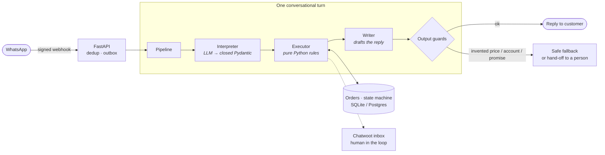
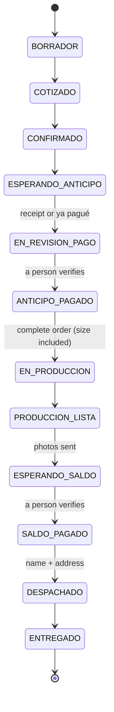

<div align="center">

# 💍 VentaBot

### A WhatsApp sales agent where **the LLM reads and Python decides**

Quotes, takes the size, lets the customer choose colours, builds the order and collects the deposit —
for a small made-to-order silver-jewellery business. Prices come from a CSV. **A payment is never confirmed by the bot.**


[**See a full conversation**](docs/ejemplo-de-conversacion.md) · [**Architecture**](#architecture-hexagonal-and-enforced) · [**Design decisions (30 ADRs)**](docs/adr/README.md) · [**Run it**](#run-it-in-60-seconds)

*🇪🇸 Bot de ventas de WhatsApp para un taller de joyería de plata: el modelo de lenguaje solo interpreta; todo lo que se decide, lo decide una tabla de Python.*

</div>

---

## Why this exists

A made-to-order jewellery shop answers the same questions all day and loses sales when nobody replies at night. VentaBot handles the **whole sale conversation** on WhatsApp — and keeps a human in charge of money.

The interesting part is *how*. Most "AI sales bots" let the model improvise; this one treats the model as an unreliable **parser** and puts every decision that costs money or trust behind deterministic code you can test:

| Principle | What it means in the code |
|---|---|
| **The LLM is a reader, not the system** | It is locked into two places (`interprete.py` and the image reader) and must return a Pydantic object with closed `Enum` fields. It cannot "decide" anything. |
| **Prices never come from the model** | They are read from a CSV; a guard rejects any amount in a draft reply that is not on the authorised list. |
| **A payment is never confirmed by the bot** | Only a person moves an order to *paid*. The bot cannot say "payment confirmed". |
| **Everything is testable offline** | A deliberately dumb "wooden model" that only recognises verbs is enough to complete a sale — proving the intelligence is in the rules, not the model. |
| **Swappable models** | Local ↔ hosted, provider A ↔ B, with automatic fallback — no business logic changes. |

> **About this public version.** The production bot belongs to a real small business. This is a **showcase copy**: names, phone numbers, bank accounts, addresses, ad IDs, customer data and product photos were removed or replaced with fictitious ones, and the git history is fresh. It shows the architecture and engineering; it is not meant to run a real shop out of the box.

## See it work

A complete sale, offline, with a "model" that only understands verbs
(`python scripts/demo_conversacion.py`):

> **👤 Customer:** Hola, quiero un anillo de 2 huellitas
>
> **🤖 Bot:** ¡Perfecto! Anoté: 2 huellitas ✨ ¿De qué color quieres el *corazón* y de qué color los *deditos*?

> **👤 Customer:** corazón lila y dedos morados
>
> **🤖 Bot:** ¡Listo! Ya tengo corazón lila / dedos morado 💕 Ahora la *huellita 2*: ¿de qué color el *corazón* y de qué color los *deditos*?

> **👤 Customer:** corazón rosa y dedos fucsia → *"Luna y Mateo"* → *talla 7* → *"Camila Torres"*
>
> **🤖 Bot:** ¡Listo! Te confirmo tu anillo 💍 corazón lila / dedos morado · corazón rosa / dedos fucsia · Luna, Mateo — **Total: $250.000** · abono de **$60.000** para iniciar la fabricación · 10 a 15 días · plata Ley 925 con 6 meses de garantía.

> **👤 Customer:** ya pagué
>
> **🤖 Bot:** ¡Gracias! 🥹 Para confirmarlo y seguir con tu pedido *PED-2026-XXXX*, ¿me compartes el comprobante por aquí? 💓 *(the order moves to "payment under review"; a person verifies it)*

[→ Read the whole conversation](docs/ejemplo-de-conversacion.md)

## Architecture (hexagonal, and enforced)



```
app/
  domain/        pure rules: prices, sizes, colours, order states, guards     ← knows nobody
  conversacion/  the conversational advisor: read → propose → validate         ← no adapters
  graph/         LangGraph flow and nodes
  adapters/      WhatsApp · Chatwoot · LLMs · vision · storage · Excel/ERP    ← no graph, no API
  api/           FastAPI: webhooks, operator panel
  workers/       outbox, reminders, retries
  infra/         settings, logging, tracing
```

`import-linter` **fails the build** if a layer imports one it shouldn't (4 contracts). Rules live in functions that run in milliseconds without internet — which is why 2,778 tests finish in under a minute.

### Order state machine



14 states, one transition table (`app/domain/order_state.py`) that the panel, Chatwoot and the bot all obey. Moving to production requires a complete order; dispatching requires shipping data — otherwise the move is rejected with exactly what is missing.

## What is worth reading in the code

- **Output guards** (`app/domain/asesora.py`) — before a draft is sent: no amount outside the authorised set, no phone/account number written by the model, no invented business name or promotion, no "payment confirmed".
- **Conversation as a pipeline** (`app/conversacion/`) — the pending question enters the interpretation, so "carmen" answering "what name to engrave?" is not read as "I want a human" ([ADR 0006](docs/adr/0006-la-expectativa-entra-en-la-interpretacion.md)).
- **Idempotent webhooks + outbox** (`app/workers/`, `app/api/`) — signature check, de-duplication, durable outbox with retries.
- **Model fallback** ([ADR 0027](docs/adr/0027-gpt-primero-claude-de-respaldo.md)) — primary model, backup model, and a pending turn that retries itself if neither answers.
- **A golden dataset** — `vb golden --solo-python` measures how much the rules alone get right, versus with the model, so the model must *earn* its latency.
- **30 ADRs** — one file per decision, with context, options and consequences. See [`docs/adr/`](docs/adr/README.md).

## Run it in 60 seconds

```bash
python -m venv .venv && source .venv/bin/activate     # Windows: .venv\Scripts\activate
pip install -r requirements-dev.txt
python scripts/demo_conversacion.py                    # a full sale in the terminal, offline
make check                                             # ruff + mypy + architecture contracts + tests
```

On Windows there is a `vb` launcher with the same commands (`vb check`, `vb server`, `vb simular "hola"`…). With `CHANNEL_BACKEND=console` replies are printed instead of sent through WhatsApp.

**Numbers:** 2,778 tests passing (+78 skipped: they measure pixels of the business's real product photos, which are not published) · `ruff` and `mypy` clean · 4 architecture contracts · 30 ADRs.

## Docs

| | |
|---|---|
| [`docs/MANUAL-VIVO.md`](docs/MANUAL-VIVO.md) | The living manual: what it does, what it measures, how it is built, what it deliberately does *not* do |
| [`docs/sistema/`](docs/sistema/README.md) | How it works today, piece by piece — sales flow, architecture, business rules, order states, Chatwoot, data & privacy, observability, ERP |
| [`docs/adr/`](docs/adr/README.md) | Why each decision was made |
| [`docs/ARQUITECTURA_CONTEXTO.md`](docs/ARQUITECTURA_CONTEXTO.md) | The context engine and model fallback |

Documentation is in Spanish (the product's language); this README and the code structure are meant to be readable without it.

## Not included on purpose

Real photos/videos (placeholders keep the file names), customer conversations, real prices and bank details, marketing data, deployment specifics and secrets (`.env` is never tracked).

## Author

Built by **Camilo Ruiz** — mechanical engineer & physicist (Universidad de los Andes), MSc in Analytics (MIAD) in progress. I build data and automation systems. → [github.com/camilo7100](https://github.com/camilo7100)

## License

MIT — see [LICENSE](LICENSE).
